# Nidito

Un computador para niños pequeños, hecho para darle vida a un netbook viejo.

Nidito es un escritorio propio escrito en Rust (sin gestor de ventanas, todo dibujado por CPU) sobre un Arch Linux mínimo, empaquetado como ISO instalable. Está pensado para equipos modestos: se desarrolló y probó en un **Samsung NC110** (Intel Atom, 1 GB de RAM, pantalla de 1024×600, BIOS sin UEFI).

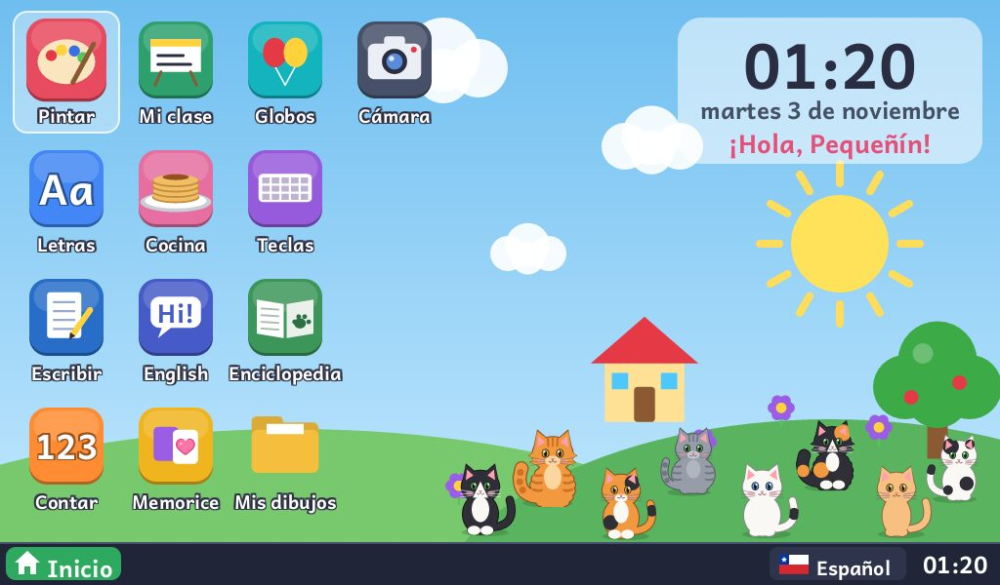

## Qué trae

- **Escritorio con ventanas reales**, barra con botón de Inicio, hora e idioma (español, inglés o ambos).
- **13 apps**: Pintar, Letras, Escribir (tipo WordPad), Contar, Mi clase, Cocina, English, Memorice, Globos, Teclas, Mis dibujos, Enciclopedia y Cámara.
- **Cámara**: se ve en espejo, cuenta 3-2-1 y saca la foto, que queda en "Mis dibujos". Solo aparece si el equipo tiene cámara (V4L2, YUYV o MJPG).
- **Enciclopedia**: temas con fotos reales y textos cortos que lee la voz, todo en una pantalla y sin deslizar. Trae dos temas: **Animales** (20, con fotos reales y el sonido de 15 de ellos, incluye fauna chilena: pudú, cóndor, pingüino de Humboldt) y **Cuerpo humano** (15 partes, con ilustraciones amables en vez de fotos).
- **Voz**: unas 820 frases pregrabadas con voces neuronales (edge-tts), procesadas para que se escuchen bien en los parlantes chicos de un netbook. Si falta alguna frase se usa espeak-ng.
- **Control de tiempo**: al encender, un adulto elige la duración de la sesión (20/30/45/60 min o sin límite). Solo cuenta el tiempo activo, y los juegos tienen un tope diario configurable (20 min por defecto). Pintar, Letras, Escribir y Mi clase no cuentan para ese tope.
- **Menú de adultos** (`Ctrl+Alt+P`, pide la clave de adultos): volumen, +10 minutos, bloquear, **Ajustes**, terminal, reiniciar, apagar y **Actualizar** (desde un pendrive, sin reinstalar). En Ajustes se cambian los minutos de juego, la pausa para los ojos y el cumpleaños; quedan guardados en `~/.config/nidito.conf`.
- **Pausa para los ojos**: cada 20 minutos de uso (configurable, 0 = nunca) aparece una pantalla de 20 segundos que pide mirar algo lejos (regla 20-20-20).
- **Cumpleaños**: ese día el escritorio tiene globos y banderines, saluda con "¡Feliz cumpleaños!" y suena "Cumpleaños feliz".
- **Instalador sin internet**: borra el disco e instala Nidito. Funciona aunque el disco traiga un Windows viejo o dañado.

## Capturas

| | |
|---|---|
| 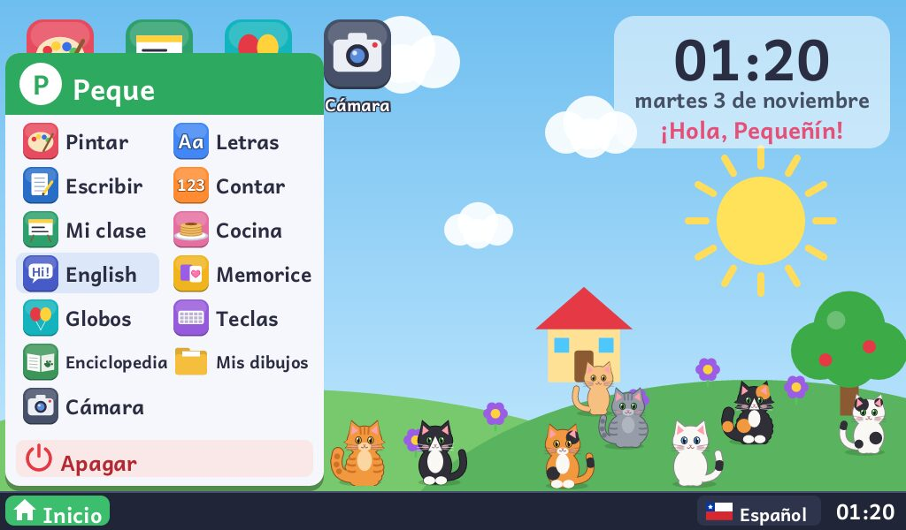 | 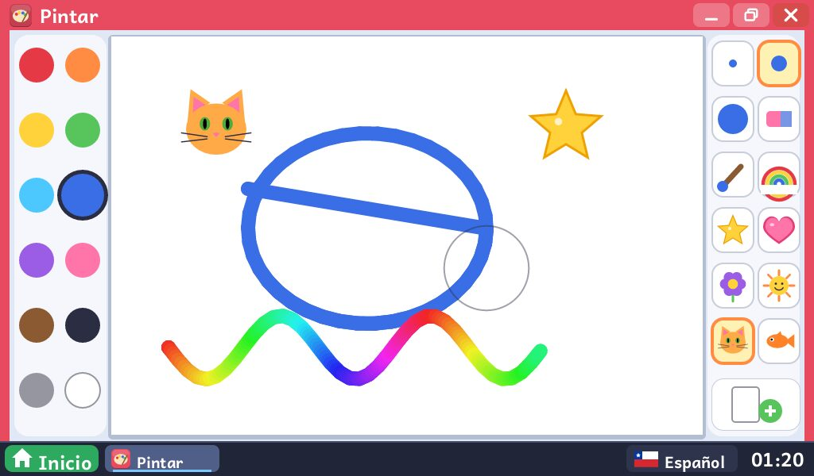 |
| Menú Inicio | Pintar |
| 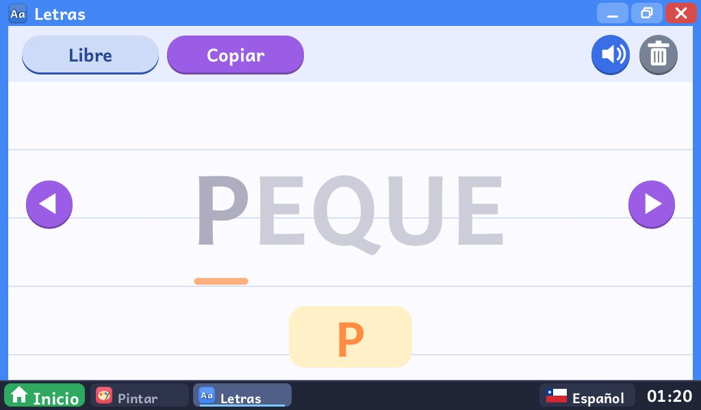 | 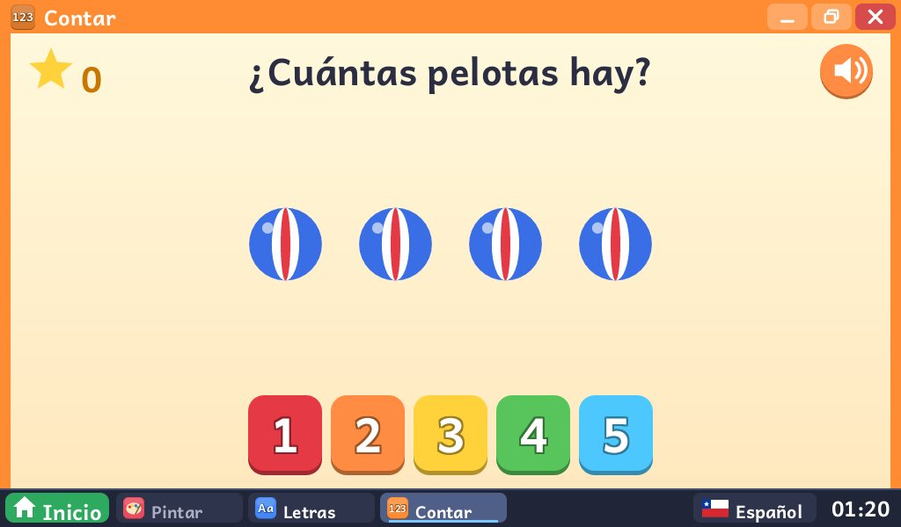 |
| Letras | Contar |
| 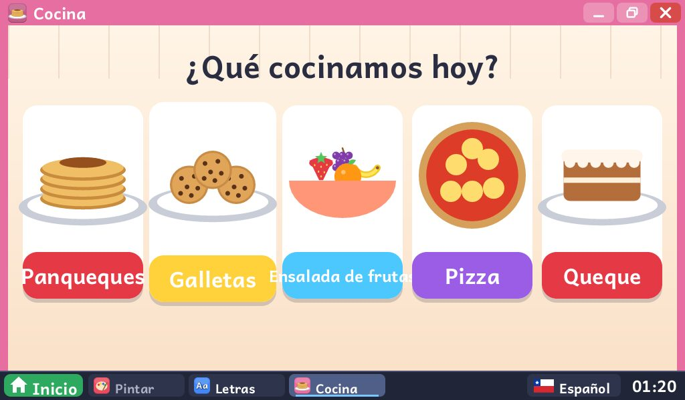 | 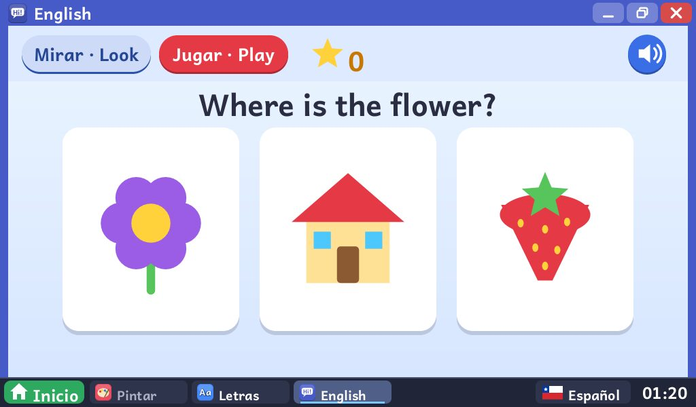 |
| Cocina | English |
| 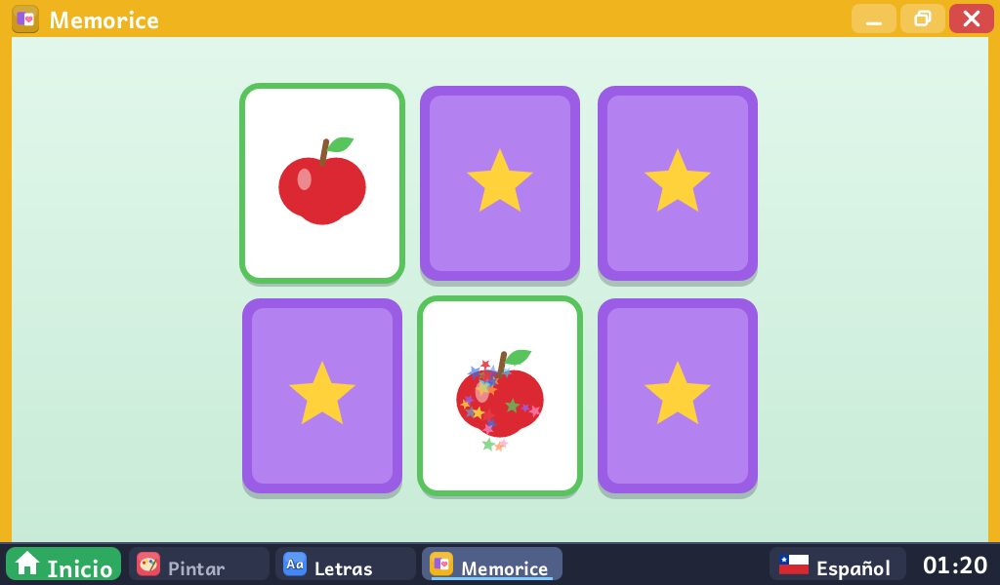 | 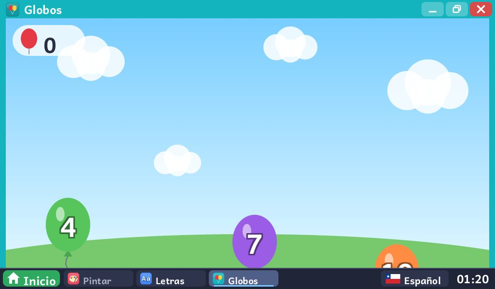 |
| Memorice | Globos |
| 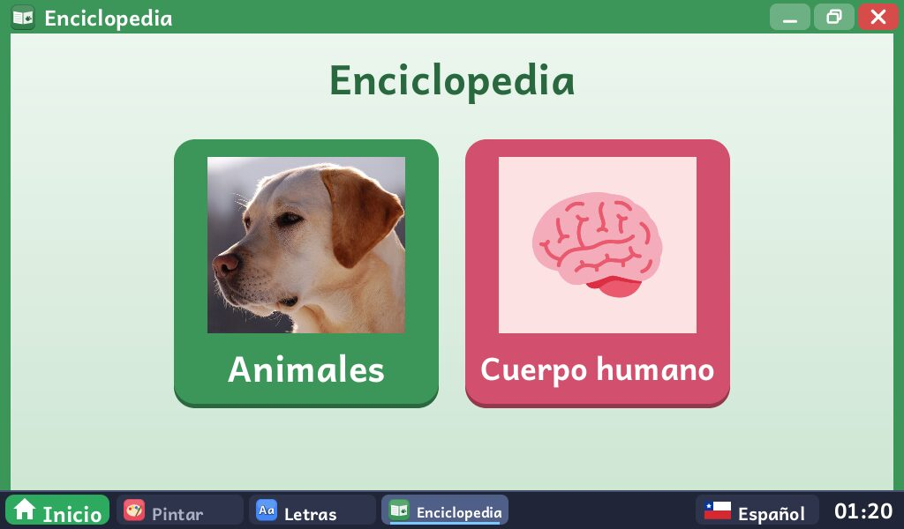 | 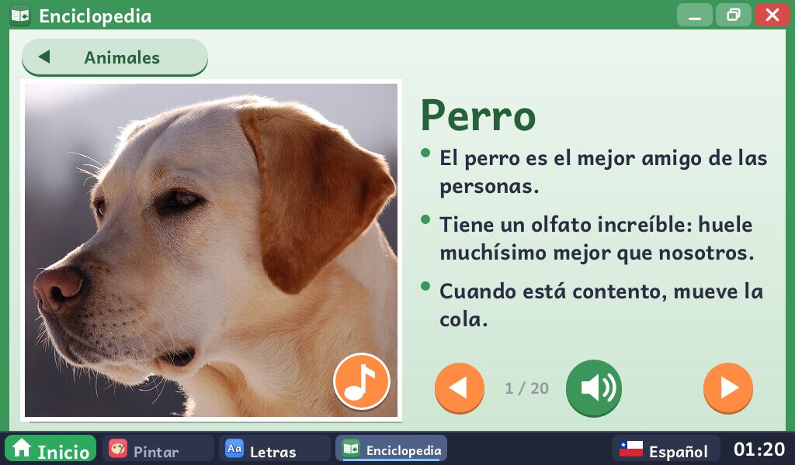 |
| Enciclopedia | Enciclopedia: animales |
| 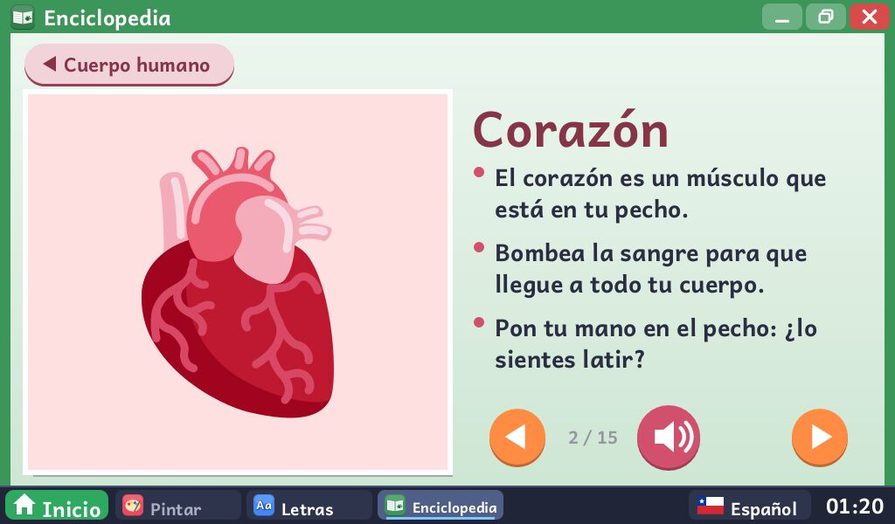 | 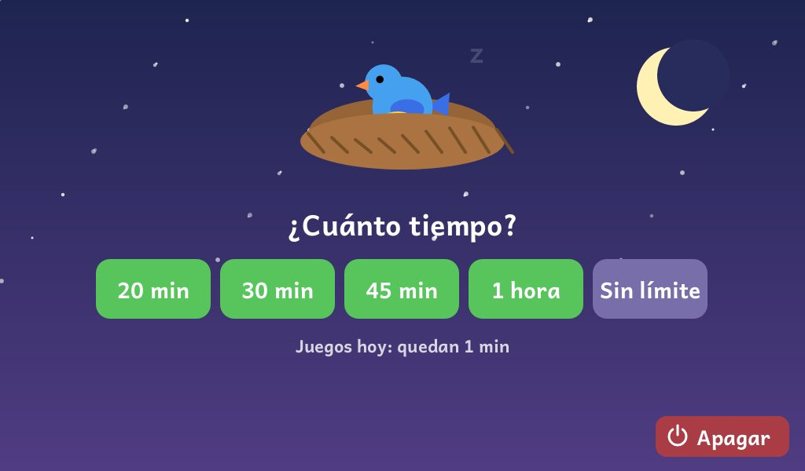 |
| Enciclopedia: cuerpo humano | Al encender: elegir el tiempo |
| 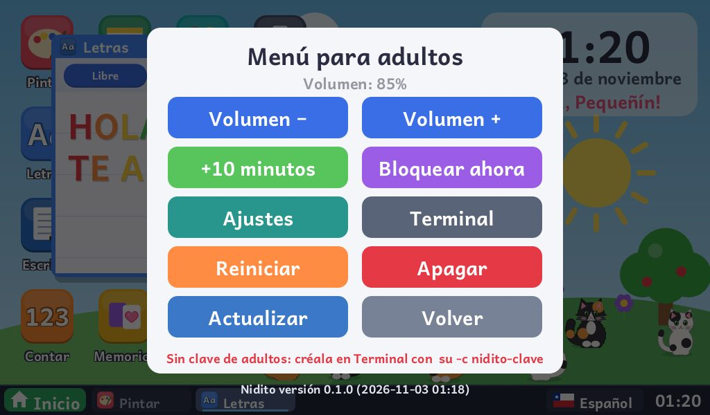 | 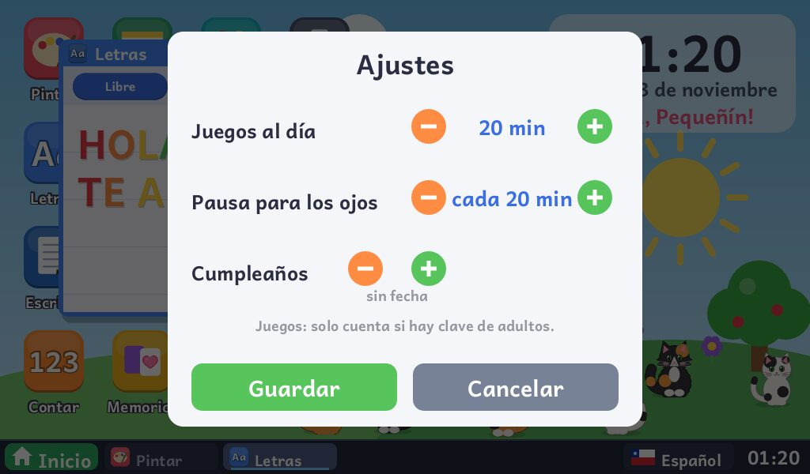 |
| Menú de adultos | Ajustes |
| 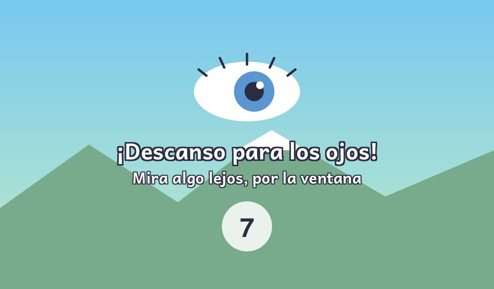 | 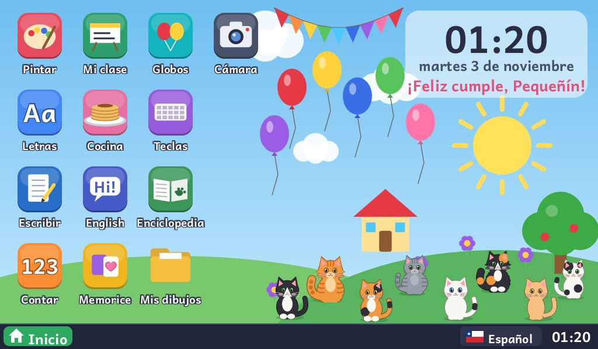 |
| Pausa para los ojos | Día de cumpleaños |

Se generan con `./escritorio/target/release/nidito --captura <carpeta>` (perfil genérico, en la resolución real del netbook: 1024×600).

## Personalizar para un niño o niña

El repositorio trae un perfil genérico (usuario `nino`, sin nombre, saluda con "¡Hola!"). Para que Nidito salude por su nombre:

```bash
./personalizar.sh                         # pregunta nombre, apodo, usuario y minutos de juego
# o directamente:
./personalizar.sh "Sofía" "Sofi"          # usuario 'sofia', 20 min de juegos
./personalizar.sh "Tomás" "" tomas 30     # sin apodo, 30 min de juegos
./personalizar.sh "Ana" "" ana 20 15-03 20  # cumpleaños 15 de marzo, pausa para los ojos cada 20 min
```

Cada perfil queda en `perfiles/<usuario>.conf`. Esa carpeta **no se sube a git**, porque contiene datos personales. Puedes tener varios perfiles (uno por niño o por equipo) y elegir cuál usar al construir.

## Construir la ISO

Requisitos (en Arch Linux): `archiso`, `rust`/`cargo`, `clang` (para compilar el acceso a la cámara), `ffmpeg`, `uv` (para instalar edge-tts) y conexión a internet para generar las voces.

```bash
./preparar.sh [usuario]      # compila, genera voces faltantes y arma build/perfil
sudo ./construir_iso.sh      # crea salida/nidito-AAAA.MM.DD-x86_64.iso
```

Si hay un solo perfil en `perfiles/`, `preparar.sh` lo usa sin preguntar. Si no hay ninguno, usa el genérico.

### Probar en una máquina virtual

```bash
./probar_vm.sh               # arranca la ISO en QEMU simulando el NC110 (BIOS, 1 GB, 1024x600)
./probar_vm.sh disco         # arranca lo que se instaló en el disco virtual
```

### Probar el escritorio sin ISO

```bash
cd escritorio && cargo build --release && cd ..
HOME=/tmp/nidito-demo NIDITO_VENTANA=1 NIDITO_VOCES=$PWD/voces/paquete \
  WAYLAND_DISPLAY= ./escritorio/target/release/nidito
```

Prueba automática con capturas de pantalla: `./escritorio/target/release/nidito --captura /tmp/cap`.

## Instalar en el netbook

1. Graba la ISO en un pendrive. **Revisa la letra con `lsblk`: `dd` borra el disco que indiques.**
   ```bash
   sudo dd if=salida/nidito-*.iso of=/dev/sdX bs=4M status=progress conv=fsync
   ```
2. Arranca el netbook desde el pendrive (en el NC110: `Esc` para el menú de arranque, `F2` para la BIOS).
3. Elige **"Instalar Nidito en este computador"**, escribe `BORRAR`, elige el teclado y define la clave de adultos.

La clave de adultos se pide al encender para elegir el tiempo de uso, y es también la clave de `root`. Para cambiarla: menú de adultos → Terminal → `su -c nidito-clave`.

### Actualizar sin reinstalar

Para llevar una versión nueva del escritorio (programa, voces y scripts de la sesión) a un Nidito ya instalado:

```bash
./preparar.sh [perfil] --actualizacion                     # deja salida/nidito-actualizacion/
./preparar.sh [perfil] --actualizacion /run/media/$USER/USB  # o la copia directo al pendrive montado
```

Copia la carpeta `nidito-actualizacion` a la raíz de un pendrive (FAT32, exFAT o ext4; no sirve el pendrive con la ISO grabada), conéctalo al netbook y entra a **menú de adultos → Actualizar** (pide la clave de adultos). No toca la clave, la configuración ni los dibujos; el programa anterior queda en `/usr/local/bin/nidito.anterior` y, si se ejecuta sin pendrive, ofrece volver a él. La versión instalada aparece bajo el menú de adultos.

Si el equipo se instaló con una ISO que aún no tiene el botón, la primera vez se hace a mano (menú de adultos → Terminal): `su`, montar el pendrive (`mount /dev/sdb1 /run/u`) y `bash /run/u/nidito-actualizacion/bin/nidito-actualizar`. Las instrucciones vienen en `LEEME.txt` dentro de la carpeta.

### Si el volumen queda bajo

En el menú de adultos → Terminal:

```bash
amixer sset PCM 100% unmute
amixer sset Speaker 100% unmute
amixer sset Master 100% unmute
```

## Estructura

| Ruta | Qué es |
|------|--------|
| `capturas/` | Imágenes del README |
| `escritorio/` | El escritorio y las apps (Rust: winit + softbuffer + tiny-skia + rodio) |
| `iso/perfil/` | Perfil de archiso: paquetes, servicios, sesión, instalador (`nidito-instalar`) |
| `iso/nidito.conf` | Configuración genérica (se instala en `/etc/nidito.conf`) |
| `enciclopedia/` | Fotos (`bajar_fotos.sh` + `animales.tsv`), sonidos (`bajar_sonidos.sh` + `sonidos.tsv`) e ilustraciones (`bajar_dibujos.sh` + `cuerpo.tsv`) de la enciclopedia, con sus créditos |
| `voces/` | Generador de voces (`generar.sh`) y filtro de audio (`filtro.txt`) |
| `personalizar.sh` | Crea el perfil de un niño en `perfiles/` |
| `preparar.sh`, `construir_iso.sh` | Construcción de la ISO (y del paquete de actualización con `--actualizacion`) |
| `probar_vm.sh` | Prueba en QEMU |

## Licencia

Código bajo licencia [MIT](LICENSE). La fuente Andika se distribuye bajo la [SIL Open Font License](escritorio/recursos/OFL.txt). Las fotos y sonidos de la enciclopedia son de Wikimedia Commons y las ilustraciones de Twemoji (CC BY 4.0); autor y licencia de cada uno en [enciclopedia/CREDITOS.md](enciclopedia/CREDITOS.md). Las voces no se incluyen en el repositorio: se generan al construir con edge-tts.
